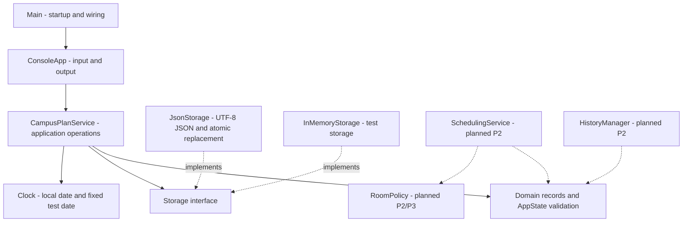
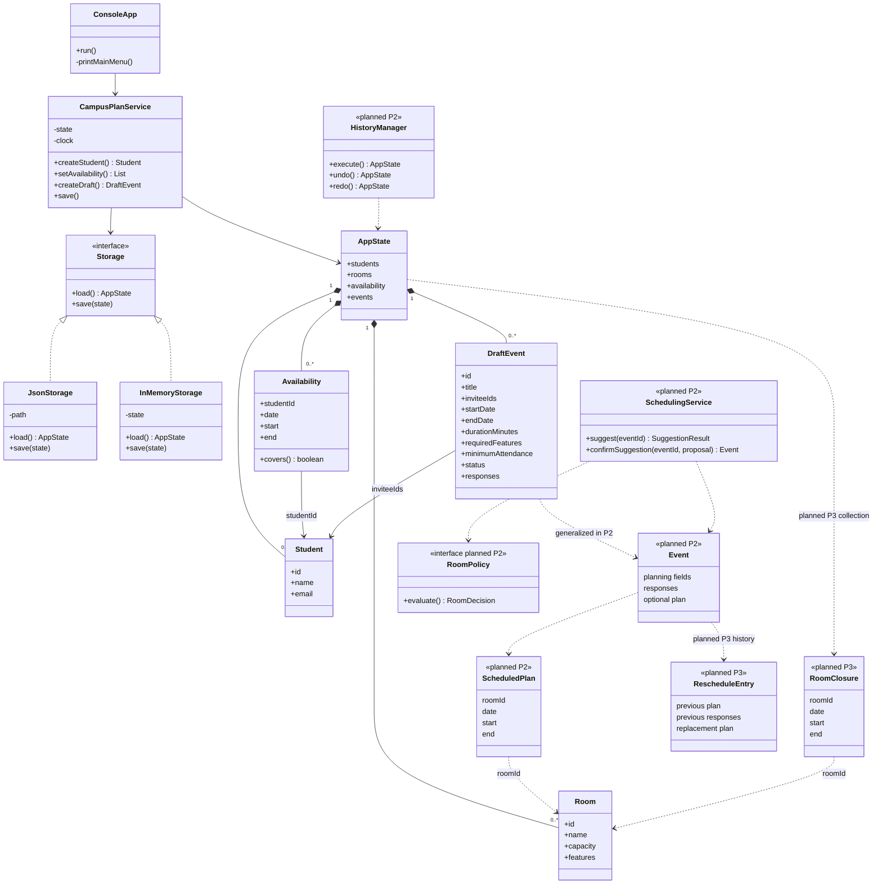
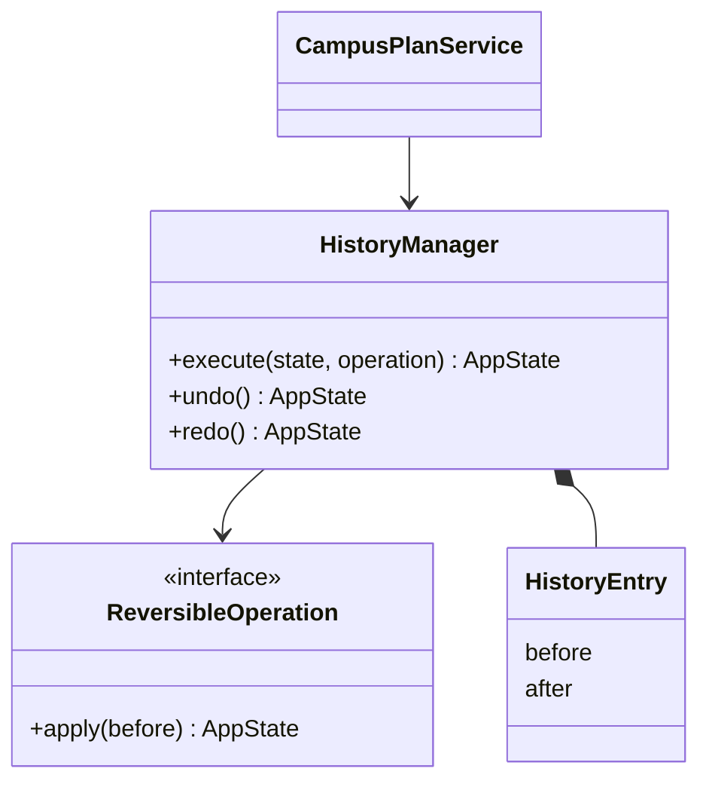
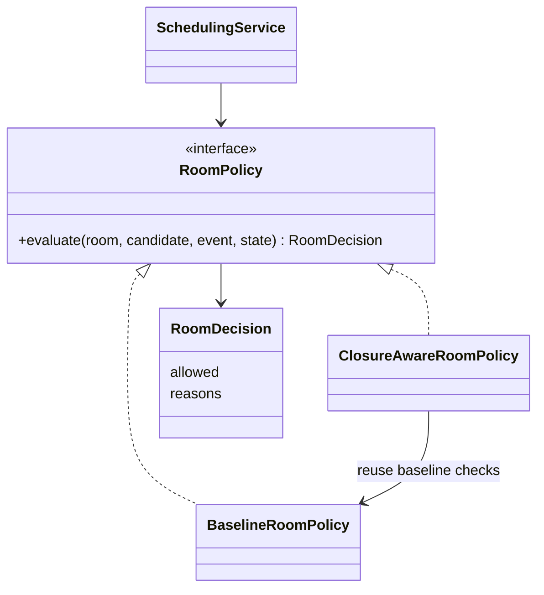

# CampusPlan design

We split CampusPlan into the CLI, application service, domain classes and storage. The CLI collects input and shows results. The service and domain classes check the rules.

The diagrams show our P1 code and the classes we plan to add in P2/P3. Future classes are labelled planned.

## Architecture



`Main` selects the save/seed paths and creates the service and CLI. The service owns the current `AppState`. Domain constructors check fields and relationships. The service receives `Storage`, so tests can replace JSON files with in-memory storage without changing business operations.

## Whole-system class diagram

In P1, `AppState` contains students, rooms, availability and drafts. We plan to extend `DraftEvent` into an `Event` model for scheduling in P2, then add closures and rescheduling history in P3. Full operation signatures are in our [interface contracts](#interface-contracts).



Rooms also use the `Feature` enum: WHITEBOARD, PROJECTOR and ACCESSIBLE. Enum values for scheduling/responses exist now, but the P1 `DraftEvent` constructor permits only DRAFT/PENDING.

## State and validation

We use records and copied collections so callers cannot change saved state through a returned list. Each service edit builds and validates a replacement before updating `state`. `AppState` checks duplicate IDs, emails and references, then merges availability for each student and date. If validation fails, the old state stays unchanged.

We use String IDs for both generated UUIDs and sample IDs such as `S1`. Edits keep the same ID. The CLI converts selected list numbers into these IDs. We fixed an earlier ID type mismatch in [PR #11](https://github.com/micobenissa/SENG-300-PROJECT/pull/11#issuecomment-6404010443).

The current/future-date policy is in the service, using an injected `Clock`. Putting it in record constructors would make a valid saved record stop loading as it ages. Tests use fixed clocks; production uses the computer's local date.

## Persistence and errors

`JsonStorage` reads/writes UTF-8 JSON and validates loaded data through the domain constructors. It rejects duplicate JSON properties, trailing content, null integer fields and fractional numbers for integer fields. Missing files return empty state; corrupt files report an `IOException` and remain unchanged.

A save validates an existing file, writes a temporary file beside it, and uses atomic replacement. If replacement fails, the previous file stays intact and temporary output is cleaned up. The service keeps completed changes in memory. The CLI reports the failure and keeps its unsaved reminder.

`IllegalArgumentException` represents invalid input/references. `IOException` represents load/save failure. Startup stops for corrupt storage; recoverable menu errors return to the main menu. Viewing and failed forms do not mark a successful mutation.

## Planned patterns

We plan to use **Command** for undo/redo and **Strategy** for room eligibility. Command will restore a complete operation. Strategy will let us add closure checks without changing the scheduling code. Both are planned for P2/P3.

[ADR 003](#adr-003-plan-reversible-commands-and-room-policies) explains the classes, tradeoffs, alternatives and tests for both patterns.

## Interface contracts

The P1 signatures match `CampusPlanService` and `Storage`. The planned signatures define what the P2/P3 components will accept, return and reject, so we can work on them separately.

### Shared rules

- IDs are nonblank `String` values. Create operations generate them; edits keep them.
- Inputs must satisfy the [domain rules](requirements.md#domain-rules). Invalid mutations throw `IllegalArgumentException` and leave the old state unchanged.
- Returned records and collections cannot be changed by the caller. All edits go through the service.
- The service owns the current state; menus do not replace it directly. P1 changes are in memory until `save()` succeeds.
- File failures use `IOException`. A failed save preserves the prior valid file and does not erase the service's unsaved state.
- One operator uses one local application instance. Concurrent writers are outside scope.

### Existing application operations

The public class is [CampusPlanService](../src/main/java/campusplan/application/CampusPlanService.java). Default construction loads from the supplied `Storage`; the overload also accepts a `Clock` for deterministic tests.

| Signature | Result and contract |
| --- | --- |
| `AppState state()` | Current immutable snapshot; does not mutate or save. |
| `Student student(String id)` | Existing record, or invalid-reference error. |
| `DraftEvent event(String id)` | Existing draft, or invalid-reference error. |
| `Student createStudent(String name, String email)` | Valid unique student under a new UUID String ID. |
| `Student editStudent(String id, String name, String email)` | Replaces that student under the same ID; duplicate/invalid fields change nothing. |
| `List<Student> searchStudents(String query)` | Case-insensitive partial name/email matches. Empty text lists all; null is rejected. |
| `List<Room> filterRooms(int minimumCapacity, Set<Feature> requiredFeatures)` | Rooms with capacity at least the request and every required feature. Capacity 1-100; a nonnull empty feature set means none. |
| `List<Availability> setAvailability(String studentId, LocalDate date, List<Availability> intervals)` | Replace only that student's date and return the merged intervals for it. Every interval must match the selected student/date. Empty list clears the date. Past dates are rejected for user changes. |
| `DraftEvent createDraft(String title, List<String> inviteeIds, LocalDate startDate, LocalDate endDate, int durationMinutes, Set<Feature> requiredFeatures, int minimumAttendance)` | Validate the whole draft and references, generate an ID, and initialize DRAFT/PENDING. Start must be today or later. |
| `DraftEvent editDraft(String id, String title, List<String> inviteeIds, LocalDate startDate, LocalDate endDate, int durationMinutes, Set<Feature> requiredFeatures, int minimumAttendance)` | Validate and replace all planning fields under the same ID. Each replacement invitee has PENDING response in P1. |
| `void loadSeed(AppState seed)` | Import a validated nonnull state only if all current domain collections are empty. Does not automatically save. |
| `void save()` | Persist the current state through Storage; propagate file failure for the CLI to report/retry. |

`Student.matches()` is a lower-level record helper which rejects blank search text. The CLI uses the service search contract above, which permits an empty query to list all.

### Existing storage interface

```java
public interface Storage {
    AppState load() throws IOException;
    void save(AppState state) throws IOException;
}
```

`load()` returns a complete valid state. `JsonStorage` treats a missing path as empty and rejects corrupt/domain-invalid files. `save()` receives an immutable nonnull state and either completes or reports failure while preserving the previous valid file. `InMemoryStorage` stores that same kind of immutable snapshot without file I/O.

### Planned P2 event model

Generalize `DraftEvent` into `Event`, retaining all current planning fields, ID and response map. Add an optional `ScheduledPlan(roomId, date, start, end)`. DRAFT has no reservation; SCHEDULED has a valid plan; CANCELLED retains its record/responses but reserves nothing. Do not treat NEEDS_REPLAN as a new EventStatus in P3: it is derived from closures.

### Planned scheduling operations

| Signature | Result and validation contract |
| --- | --- |
| `SuggestionResult suggest(String eventId)` | Read-only enumeration/ranking for a draft. Return up to five immutable suggestions plus room-failure and attendance-failure counts. Count room failures first so categories do not overlap. |
| `Event confirmSuggestion(String eventId, Suggestion proposal)` | Revalidate event version, dates, room, features, capacity and eligible attendance. Only then install the complete plan/reservation. A stale/invalid proposal changes nothing. |
| `Event cancelEvent(String eventId)` | Called only after UI confirmation. Retain record/responses and free all commitments. Cancelling the prompt must not call this mutation. A cancelled event cannot be scheduled again. |
| `Event setResponse(String eventId, String studentId, AttendanceResponse response)` | Require an invitee of a scheduled event. ACCEPTED requires full availability and no overlapping accepted attendance elsewhere. PENDING/DECLINED release that participant commitment. |
| `List<Event> listEvents(LocalDate date, EventStatus status)` | Read-only filtering; no filter means all events. Show details separately from eligible counts. |
| `void exportRoster(String eventId, Path destination)` | UTF-8 CSV with `student_id,name,email,response`; quote commas, quotes and line breaks. Propagate I/O failure; do not add to undo history. |

Each `Suggestion` contains event/room IDs, date/start/end, eligible IDs, ineligible IDs with reasons, and a session state revision. Confirmation recomputes the rules rather than trusting displayed counts. Proposals are not reservations and are not persisted. Mutations advance the revision; previews/exports do not.

Availability edits in P2 must also identify and reject changes that invalidate existing ACCEPTED attendance. The organizer changes the response or cancels the event first. Ranking and half-open conflict rules are defined in [requirements](requirements.md#later-release-acceptance).

### Planned reversible operations

| Signature | Contract |
| --- | --- |
| `AppState execute(AppState before, ReversibleOperation operation)` | Validate/execute a complete mutation, then keep immutable before/after snapshots as one history entry. A failure changes neither state nor history. |
| `AppState undo()` | Restore the complete previous snapshot and move that entry to redo; report when history is empty. |
| `AppState redo()` | Restore the corresponding after snapshot and move the entry back to undo. |

`HistoryManager` owns history entries; the application service installs the returned state. Keep at least 20 successful operations. A new successful mutation after undo clears redo. Saving after undo writes the restored state. Viewing, exports, failed forms, cancelled confirmations and seed loading do not enter history. History is session-only.

### Planned P3 operations

| Signature | Contract |
| --- | --- |
| `RoomClosure addClosure(String roomId, LocalDate date, LocalTime start, LocalTime end)` | Validate the room and interval; reject an exact duplicate. Overlapping closures are allowed and act as their union. |
| `void removeClosure(String closureId)` | Remove one known closure and recompute affected-event flags. |
| `List<Event> affectedEvents()` | Scheduled plans intersecting a current closure, retaining their current reservations and responses. |
| `ReplacementPreview previewReplacement(String eventId, Suggestion proposal)` | Read-only old/new plan, eligible students, students losing eligibility and responses that would reset. Ignore only this event's own current commitments while evaluating alternatives; exclude its identical plan. |
| `Event confirmReplacement(ReplacementPreview preview)` | Revalidate and atomically replace plan/reservation plus history. Changed date/time resets every response to PENDING; a room-only change preserves responses. Failure changes nothing. |

P3 storage adds an explicit format version, closures and rescheduling history. Load valid P2 data without manual changes, retain IDs/responses, and initialize new collections empty. Back up the original before the first migrated save. Migration errors must not overwrite it. Undo/redo restores the complete prior plan, responses and history; a restored plan may still need replanning under existing closures.

## Architecture decisions

### ADR 001 Separate the CLI from application rules

#### Status

Accepted and implemented in P1.

#### Context

We needed to test the rules without running the CLI. Keeping the rules inside menus would also make them harder to reuse when adding scheduling.

#### Alternatives

| Option | Tradeoff |
| --- | --- |
| Put everything in the CLI | Fewer initial classes, but rules, storage and prompts become coupled. |
| Let menus edit shared lists | Easy to start; invalid or partial updates can leak into current state. |
| Use an application service with validated domain snapshots | More explicit boundaries, but operations can be tested and reused without the UI. |

#### Decision

We put input/output in `ConsoleApp`, operations in `CampusPlanService`, validation in the domain records and `AppState`, and file access behind `Storage`. Menus pass complete inputs to the service. We update the state only after the replacement passes validation.

Inject a `Clock` for the current/future-date policy. Keep that policy at the service boundary so historical JSON can still load; use fixed clocks in tests.

#### Consequences

The CLI can change its layout without changing the rules. Invalid edits leave existing state untouched, and service tests do not need menu input. We must keep prompts and domain errors consistent and avoid duplicating business operations in the CLI.

#### Validation

`CampusPlanServiceTest` covers operations and state preservation through test storage. `ConsoleAppTest` covers delegation and end-to-end forms. `PastDateTest` covers deterministic dates and historical reloads. [PR #14](https://github.com/micobenissa/SENG-300-PROJECT/pull/14) connects the domain and storage; [PR #15](https://github.com/micobenissa/SENG-300-PROJECT/pull/15) adds the CLI.

### ADR 002 Preserve valid state when storage fails

#### Status

Accepted and implemented in P1. Commit `40d35ac` adds the fractional-number regression fix.

#### Context

We needed records to survive a restart. A missing file should start empty, but a corrupt file should show an error. A failed save must keep the previous valid file and let the user retry.

#### Alternatives

| Option | Tradeoff |
| --- | --- |
| Write directly over the destination | Simple, but a partial write can destroy the valid save. |
| Replace bad input with empty state | Makes startup appear successful while hiding lost/corrupt data. |
| Use a storage interface and atomic replacement | Adds a temporary file and explicit errors; protects the old save. |

#### Decision

We use `Storage` with two implementations: `InMemoryStorage` for tests and `JsonStorage` for files. Jackson and its Java-time module read and write our UTF-8 JSON.

Missing storage returns empty state. Invalid JSON, references or domain values produce a clear load error. Reject trailing tokens, duplicate properties, invalid null integer values and fractional tokens for integer fields.

On save, validate an existing file, write a temporary file in the same directory, then atomically replace the destination. If atomic replacement is unsupported or fails, report the error rather than falling back to a riskier write. Keep unsaved state in memory and remove temporary output.

#### Consequences

Normal restart preserves IDs and relationships. Corrupt files remain available for recovery, and a failed save can be retried. A filesystem must support atomic replacement; there is no multi-writer conflict management because concurrent users are outside scope. The README must explain backups and custom data paths.

#### Failure found and fixed

Disabling general scalar coercion did not stop Jackson from converting `180.9` to integer `180` before domain validation. Capacity `100.9` and attendance above the invited count had the same problem. We disabled `ACCEPT_FLOAT_AS_INT` and added three regression cases checking load/save rejection and unchanged file bytes.

`JsonStorageTest.fractionalIntegersAreRejectedWithoutOverwritingStorage` covers the fix. Our original persistence work is in [PR #14](https://github.com/micobenissa/SENG-300-PROJECT/pull/14).

#### Validation

`JsonStorageTest` checks UTF-8 round trips, IDs, invalid data, corrupt-file protection and simulated failed atomic replacement. `ConsoleAppTest` checks that a failed save leaves changes in memory. Independent packaged-JAR checks also forced a real Windows file-replacement failure and verified the previous file remained intact.

### ADR 003 Plan reversible commands and room policies

#### Status

Planned for P2/P3. The classes and tests below are our proposed design.

#### Context

P2 must undo and redo complete operations, including related reservations. P3 adds closures and rescheduling without changing the requirement to preserve coherent state. Room qualification also gains a distinct new rule: a room may otherwise fit but be closed for that interval.

#### Command for reversible operations

**Problem:** undo must restore the plan, room reservation and responses together.

**Planned participants:** `ReversibleOperation`, mutation commands, `HistoryEntry(before, after)`, and `HistoryManager` in `application.history`; `CampusPlanService` installs the returned immutable state.



The operation validates/builds the after state before history changes. The manager records one complete before/after pair, restores snapshots for undo/redo, and clears redo after a new successful mutation. Keep at least 20 entries. Failures, exports and cancelled previews add nothing. Seed loading is outside history.

**Benefit:** one undo restores the full state. **Cost:** keeping before/after copies uses memory, and all edits must go through the history manager. **Alternative:** restore fields separately in each menu, but that risks missing part of an operation.

**Planned tests:** undo after scheduling restores room/participant commitments; redo restores them again; a new mutation clears redo; failed validation/export does not enter history; 20 operations remain reversible; rescheduling undo restores plan, responses and history together.

#### Strategy for room eligibility

**Problem:** P3 adds closures to the existing room capacity, feature and reservation checks. We want to test those rules separately from ranking.

**Planned participants:** `RoomPolicy` interface, `BaselineRoomPolicy`, `ClosureAwareRoomPolicy`, `RoomDecision` and `SchedulingService` in `application.scheduling`. P1 room filtering remains a direct service predicate and is not claimed as this pattern.



The scheduler asks the selected policy for a room decision before evaluating attendance. P2 uses the baseline policy. P3 adds closure-aware evaluation while preserving the same scheduler contract and rejection reasons.

**Benefit:** we can add and test closure rules without changing ranking or undo. **Cost:** we add an interface and two implementations. **Alternative:** keep one room-checking method in the scheduler if the rules stay small enough.

**Planned tests:** capacity uses every invitee, all features must match, actual reservations overlap but adjacent ones do not; closure union blocks intersecting candidates; removing a closure restores baseline qualification; room failures are counted before attendance failures.

#### Consequences and review

We will test Command and Strategy as we implement them in P2/P3. In P3, we will review this decision against the closure and rescheduling changes and update the ADR with what changed.
